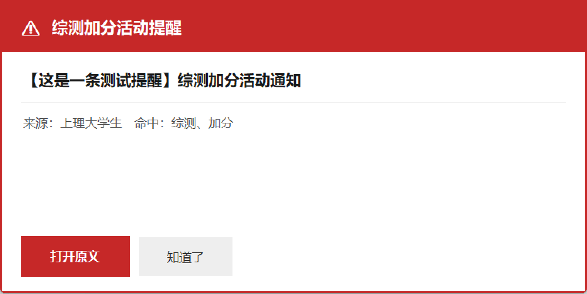

# 综测加分活动提醒

> 监控**任意**微信公众号，标题命中关键词时立刻在桌面弹窗 + 响提示音 + 发邮件到手机。

微信公众号没有公开的订阅接口，所以这个工具走的是「第三方监测服务 → Webhook → 本机」的链路：
云端发现新文章后主动推送给你电脑上的这个程序，程序负责筛选、去重、提醒。
不需要你反复手动刷新公众号列表。

<p align="center">
  
</p>

<p align="center">
  
  <br>
  <sub>静默运行时只在托盘区留一个图标，不占屏幕</sub>
</p>

---

## 特性

| | |
|---|---|
| **关键词筛选** | 标题（或标题+摘要）命中任意关键词才提醒，噪音可控 |
| **桌面弹窗** | 大号居中红色窗口 + 提示音，置顶显示，一眼就能看到 |
| **邮件推送** | 同时发一封 HTML 邮件到你手机，出门在外也不会漏 |
| **永久去重** | SQLite 记录已提醒文章，重启不重复弹，同一篇只响一次 |
| **静默后台** | 开机自启时**不弹任何窗口**，托盘图标即入口 |
| **零硬依赖** | 核心只用 Python 标准库；托盘/自启等能力按需安装 |
| **凭据分离** | `config.json` 可安全分享，token 与授权码单独存放并被 git 忽略 |

**平台**：仅支持 **Windows 10/11**（用到了 `winsound`、`pywin32`、`os.startfile` 等 Windows 专有 API）。
**Python**：3.8 或更高。

---

## 快速开始

```bash
git clone <本仓库地址>
cd zongce-alert

# 1. 装可选依赖（托盘图标 + 开机自启）
pip install -e ".[tray,win]"

# 2. 生成回调 token（自动写入 secrets.local.json）
python run.py --gen-token

# 3. 验证弹窗和声音
python run.py --test

# 4. 正式启动
python run.py --tray
```

启动后浏览器打开 `http://127.0.0.1:8765/health?token=你的token`，
返回 `{"ok": true}` 即表示服务正常。

接下来需要接一个监测服务来投递文章，完整流程见 **[docs/QUICKSTART.md](docs/QUICKSTART.md)**。

---

## 它怎么工作

```
监测服务（云端盯号，1-5 分钟发现新文章）
        ↓ Webhook 推送
公网隧道（把公网请求转到你电脑，二选一）
   · Cloudflare 快速隧道 —— 免费，地址每次重启会变
   · Tailscale Funnel   —— 免费，地址固定不变（推荐）
        ↓
本程序（127.0.0.1:8765）
        ├─ 解析 payload（自适应，不挑服务商）
        ├─ 关键词筛选
        ├─ 去重（已提醒过的不再响）
        └─ 弹窗 + 提示音 + 邮件
```

程序本身**不绑定任何特定服务商**——webhook 解析器是自适应的，换一家监测服务基本不用改代码。
详见 **[docs/PROVIDERS.md](docs/PROVIDERS.md)**。

> 本项目的起因是监控上海理工大学「上理大学生」公众号的综测加分活动，
> 但只要改一下关键词，任何公众号都能用。上理只是使用示例之一。

---

## 文档

| 文档 | 内容 |
|---|---|
| [快速开始](docs/QUICKSTART.md) | 从零到收到第一条提醒的完整五步 |
| [配置说明](docs/CONFIG.md) | 所有配置项、关键词调优、端口与存储 |
| [服务商替换](docs/PROVIDERS.md) | 换掉当前监测服务要做什么（通常什么都不用做） |
| [安全设计](docs/SECURITY.md) | 鉴权、凭据管理、公网暴露面的防护 |
| [疑难排查](docs/TROUBLESHOOTING.md) | 不弹窗、隧道断、端口占用等常见问题 |

---

## 费用

程序本身免费（MIT）。需要花钱的只有「盯着公众号」这件事：

| 项目 | 费用 |
|---|---|
| 第三方监测服务 | 约 ¥3 / 月 / 个公众号（各服务商定价不同） |
| Cloudflare 快速隧道 | 免费 |
| Tailscale Funnel | 免费（需免费账号） |
| 邮件 | 免费 |
| 本程序 | 免费 |

> 选服务商时优先看**按公众号数量计费**而非按查询次数计费——后者查得勤费用会失控。

---

## 开发

```bash
pip install -e ".[dev]"
python -m unittest discover -s tests -v
```

当前 **147** 个测试，覆盖解析、筛选、去重、鉴权、启动失败、项目包装。

维护注意：`.bat` 文件必须保持 **CRLF 换行、无 BOM**，否则 Windows 下 `goto` 标签会失效。

---

## 许可证

[MIT](LICENSE)
